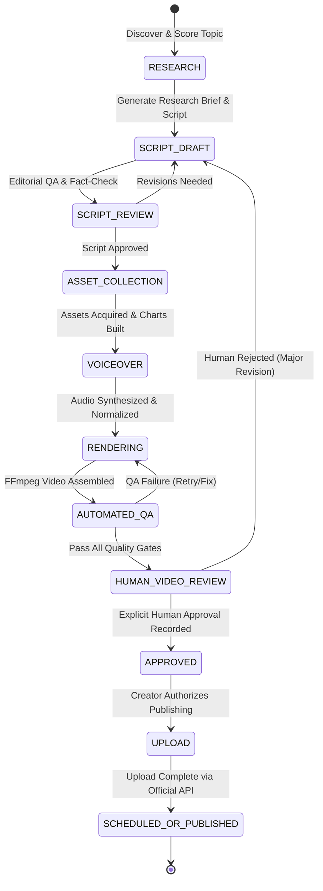

# System Architecture: Faceless Media Studio

## 1. Architectural Philosophy & Design Principles

**Faceless Media Studio** is designed as a **local-first, privacy-respecting, zero-cost-by-default** YouTube production automation suite. It runs entirely on the creator's machine, eliminating reliance on recurring cloud subscriptions, paid databases, or third-party workflow platforms.

### Core Principles
1. **Local-First Reliability:** Runs on local Python, SQLite, and direct FFmpeg binaries. The studio functions even without active internet connectivity (using local TTS and procedural visual generation).
2. **Mandatory Human-in-the-Loop Safety:** Automated preparation with strict human review. Videos can never be published automatically; each version requires explicit human approval.
3. **Strict Free-First Toolchain:** Default monthly spending limit is ₹0, with an absolute hard ceiling of ₹3,000. Every external service call checks the budget before execution.
4. **Originality & Compliance by Construction:** Procedural chart generation, factual source citation ledgers, and licensed B-roll prevent copyright strikes, demonetization, or repetitive content flags.
5. **Deterministic State Machine:** A video moves through explicit, verifiable state transitions. Any material modification invalidates downstream approval.

---

## 2. End-to-End Pipeline State Machine



### State Machine Transition Rules
- **RESEARCH:** Topic discovered, scored across 7 metrics, verified against existing database to prevent topic duplication.
- **SCRIPT_DRAFT:** Script written with opening hook, context, evidence, concrete case study, and conclusion. Claim ledger records facts, dates, and primary sources.
- **SCRIPT_REVIEW:** 12-point automated editorial QA scorecard checks hook strength, readability, advertiser safety, and retention risks.
- **ASSET_COLLECTION:** Collects charts (procedural Matplotlib), licensed stock imagery/video, and archival exhibits with strict copyright metadata.
- **VOICEOVER:** Synthesizes natural English audio via Microsoft Edge Neural TTS (or local offline SAPI5/pyttsx3) with audio normalization and sentence alignment.
- **RENDERING:** Direct FFmpeg orchestration compiles video layers: backgrounds, motion zooms, text cards, data charts, subtitles, and licensed background music into 1080p MP4.
- **AUTOMATED_QA:** Validates video stream integrity, checks for blank frames, audio silence, duration bounds, and file integrity.
- **HUMAN_VIDEO_REVIEW:** Side-by-side preview with script, claim ledger, thumbnail, titles, and compliance checklist.
- **APPROVED:** Cryptographic content hash + approval timestamp recorded. **Any modification to script, audio, or video invalidates approval.**
- **UPLOAD:** Protected by OAuth 2.0 token checks. Uploads to YouTube as Private/Unlisted by default.

---

## 3. Component & Service Architecture

```
faceless-media-studio/
├── app.py                      # Main Streamlit Dashboard Application
├── requirements.txt            # Pinned Python Dependencies
├── .env.example                # Safe environment variable template
├── config/
│   └── settings.py             # System configuration, paths, budget limits
├── src/
│   ├── database/               # SQLite ORM, Migrations, State Machine
│   │   ├── connection.py
│   │   ├── models.py
│   │   └── repository.py
│   ├── research/               # Topic discovery, scoring, competitor tracker
│   │   ├── discovery.py
│   │   ├── scoring.py
│   │   └── competitors.py
│   ├── scripting/              # Script generation, claim ledger, storyboards
│   │   ├── generator.py
│   │   ├── ledger.py
│   │   └── templates.py
│   ├── quality/                # Editorial gates, compliance, audio/video checks
│   │   ├── editorial_qa.py
│   │   ├── policy_checker.py
│   │   └── media_validator.py
│   ├── tts/                    # Voice synthesis, normalization, alignment
│   │   ├── voice_engine.py
│   │   └── audio_processor.py
│   ├── assets/                 # Charts, image generators, license registry
│   │   ├── chart_generator.py
│   │   ├── thumbnail_designer.py
│   │   └── license_tracker.py
│   ├── editing/                # FFmpeg engine, transitions, subtitle generator
│   │   ├── ffmpeg_orchestrator.py
│   │   ├── timeline.py
│   │   └── subtitles.py
│   ├── youtube/                # YouTube Data API v3, OAuth 2.0, uploader
│   │   ├── oauth.py
│   │   ├── uploader.py
│   │   └── metadata.py
│   ├── analytics/              # YouTube Analytics API, retention & experiments
│   │   ├── tracker.py
│   │   ├── learning_loop.py
│   │   └── revenue_calculator.py
│   └── workflows/              # Daily automation, scheduled runs, operational summaries
│       ├── daily_runner.py
│       └── reporter.py
├── data/                       # SQLite DB (`studio.db`), cached metadata
├── projects/                   # Per-video workspace folders (scripts, assets, logs)
├── exports/                    # Final rendered MP4s and thumbnails
├── logs/                       # Application & FFmpeg process logs
├── tests/                      # Automated pytest suite
└── docs/                       # Technical & Strategic documentation
```

---

## 4. SQLite Persistent Data Model

The application uses SQLite with foreign key enforcement and transactional integrity:

1. **`channels`**: Channel profile, target niche, editorial promise, target RPM, currency, monthly budget ceiling.
2. **`topics`**: Topic candidate, category pillar, demand/commercial/differentiation scores, total score, rationale, status (`backlog`, `selected`, `in_production`, `published`, `rejected`).
3. **`sources`**: Research URLs, publication titles, excerpt notes, credibility ratings.
4. **`claim_ledger`**: Granular factual claims linked to specific script scenes, timestamps, and primary source citations.
5. **`scripts`**: Script versions, word counts, target durations, hook text, conclusion, approval status, content hash.
6. **`storyboards`**: Scene sequence, scene duration, narration text, visual cue, asset IDs, on-screen text.
7. **`assets`**: Visual asset ID, file path, asset type (chart, stock_photo, illustration, b-roll, audio), source URL, license type, commercial use allowed (bool), attribution required.
8. **`voiceovers`**: Audio file path, TTS engine used, voice ID, speaking rate, duration, normalization status.
9. **`render_jobs`**: Job ID, project ID, resolution, framerate, status (`queued`, `rendering`, `completed`, `failed`), progress %, error message, duration.
10. **`video_exports`**: File path, resolution, duration, video codec, audio codec, file size, hash, verification status.
11. **`approvals`**: Project ID, content hash, approved_by, approved_at, notes, is_valid (bool).
12. **`youtube_uploads`**: YouTube video ID, upload status, privacy status (`private`, `unlisted`, `public`), scheduled publish time, upload timestamp, response payload.
13. **`analytics_snapshots`**: Date, views, watch time, impressions, CTR, average view duration, APV, estimated revenue.
14. **`cost_records`**: Service name, operation description, estimated cost INR, actual cost INR, timestamp, within_budget (bool).
15. **`workflow_logs`**: Job name, status, duration, message, timestamp.

---

## 5. Free-First Integration Strategy & Fallback Hierarchy

| Capability | Free Primary Option | Free Fallback Option | Optional Paid Tier (Capped) |
|---|---|---|---|
| **Text-to-Speech** | **Microsoft Edge-TTS** (Ultra-natural neural voices: `en-US-ChristopherNeural`, `en-US-GuyNeural`, free, no key) | **pyttsx3 / Windows SAPI5** (100% offline, zero internet) | ElevenLabs (Only if creator explicitly approves & within ₹3,000 budget) |
| **Video Rendering** | **Direct FFmpeg 9.x** (Hardware-accelerated libx264/aac, zero cost, open source) | MoviePy / PIL direct stitcher | Local dedicated GPU render queue |
| **Data Visuals & Charts** | **Python Matplotlib & Seaborn** (Procedural high-res 1080p charts, bar races, stock lines) | PIL text & graphic generator | Custom Figma templates |
| **Stock B-roll & Photos** | **Pexels & Pixabay Free APIs** + Public Domain Archives (Wikimedia Commons, SEC exhibits) | Local curated asset cache | Storyblocks (Not needed for MVP) |
| **YouTube Publishing** | **Official YouTube Data API v3** (10,000 daily quota units free) | Manual Upload Package Export (ZIP with MP4, thumbnail, metadata) | Third-party scheduling SaaS (Prohibited) |
| **Channel Analytics** | **YouTube Analytics API** (Direct OAuth 2.0 authorized access) | Manual CSV import from YouTube Studio | Paid analytics subscriptions (Prohibited) |

---

## 6. Budget Tracker & Financial Safety Circuit

The application includes an active safety circuit:
- **Default Budget:** ₹0 per month.
- **Maximum Ceiling:** ₹3,000 per month.
- Every external API invocation passes through `CostManager.check_budget(service_name, estimated_cost_inr)`.
- If the estimated cost would exceed the monthly ceiling, the execution is **immediately blocked** and an alert is raised in the dashboard.
- Zero funds can be spent without explicit creator authorization.
